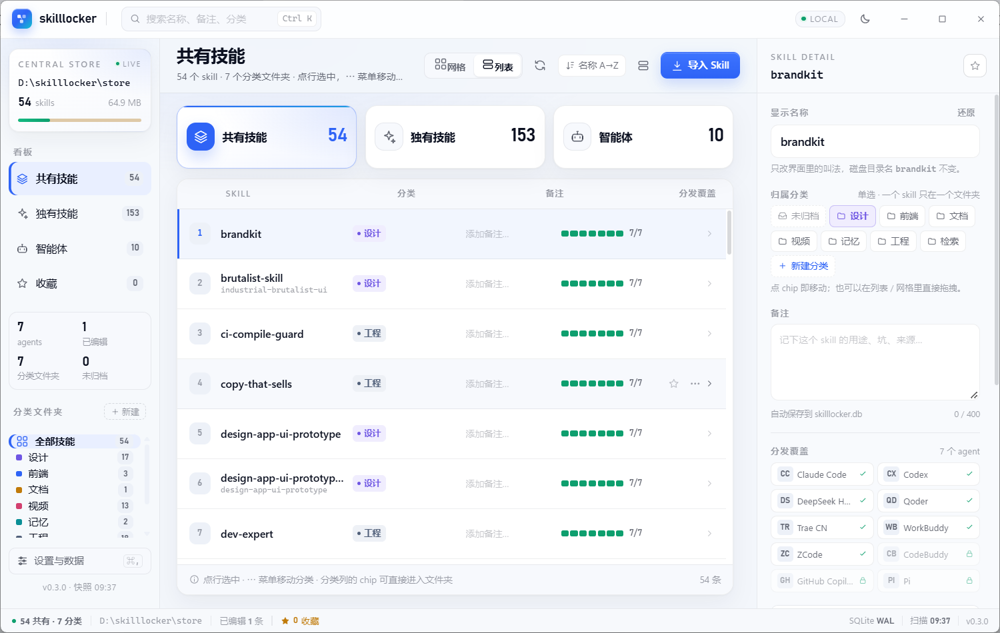
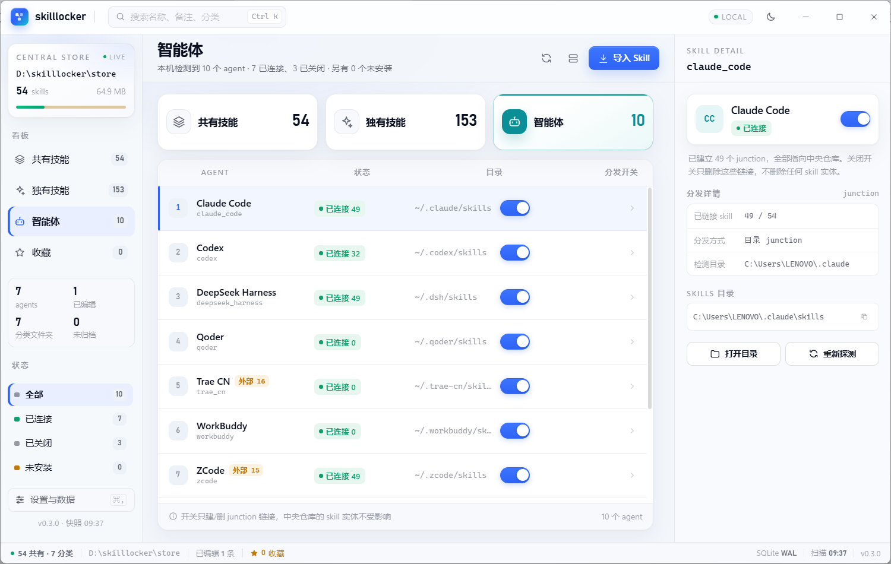
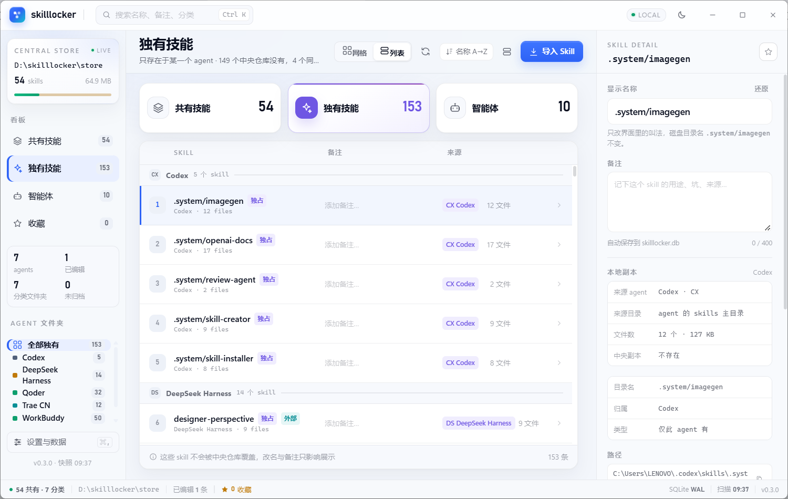
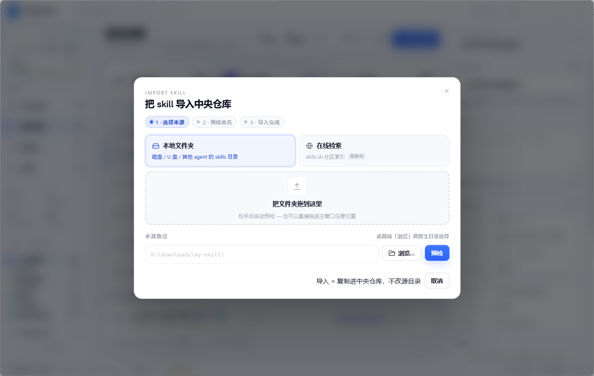

# SkillLocker

本地 Agent Skills 管理器（Windows 桌面端）。扫描中央仓库里的 `SKILL.md` 建立技能库，再通过 junction（失败时回退为复制）分发到 Cursor、Claude Code、Codex、DeepSeek Harness 等 agent 的全局 skills 目录，并用一张「技能 × 工具」矩阵统一查看、修复和清理分发状态。

## 界面预览

<table>
  <tr>
    <td width="50%"><br><sub>共有技能库 · 分类 / 备注 / 分发覆盖</sub></td>
    <td width="50%"><br><sub>智能体列表 · junction 分发开关</sub></td>
  </tr>
  <tr>
    <td width="50%"><br><sub>各 agent 独有技能 · 来源与本地副本</sub></td>
    <td width="50%"><br><sub>导入 Skill · 本地文件夹 / 在线检索</sub></td>
  </tr>
</table>

## 功能

- 扫描中央仓库：登记技能名称、分类、备注与内容哈希
- 分发矩阵：一键建立 / 修复各工具的 skill 链接；新入库技能按「分发开关」自动补链，识别缺失、漂移与冲突
- 导入外部 skill、撤链、删除，以及把「独有」技能转为「共有」
- 内容哈希冲突检测，`verify` 只报告不改动
- 无边框桌面界面（pywebview）与完整 CLI
- Windows 下所有删除先判断 reparse point，不顺着链接递归删实体

## 安装版（普通用户）

直接下载 [SkillLocker-Setup-v0.3.6.exe](https://2026heshao.github.io/skilllocker/SkillLocker-Setup-v0.3.6.exe)（官网站内直链），或从 [GitHub Release v0.3.6](https://github.com/2026heshao/skilllocker/releases/tag/v0.3.6) 获取同一份安装包；校验值见仓库内 `release/SkillLocker-Setup-v0.3.6.exe.sha256`。安装包自带 Python 运行时，不需要装 Python，也不需要运行 bat 或手动放置 skill。

安装后从开始菜单或桌面打开 SkillLocker。中央仓库默认就在**安装目录的 `store\`**（看得见、带得走）；数据库、配置、WebView2 profile 和日志在 `%LOCALAPPDATA%\SkillLocker`。安装包不预置任何技能。

**首次启动会自动完成中央仓库**：如果各 agent 目录里的 skill 链接已经汇聚到同一份仓库（升级安装、或之前用过别的管理器），应用会直接接管它（只写 `config.json` 并重新登记，不搬文件）；没有现成仓库时，扫描各 agent 的主 `skills` 目录，把两个以上 agent 都装了的共有技能（本机只有一个 agent 时则取它目录里的全部技能）按真身拷进仓库。全程只写自己的 `store\`，不改 agent 目录、不建链接（分发开关仍由你决定）。同名不同内容不会自动选边，会留在独有看板由你处置。

自动接管 / 建库之后，人工出口仍然保留、降级为次级提示：

- **接管本机已有的中央仓库**：自动接管失败时才需要手动点；只写 `config.json` 并重新登记，不搬文件
- **补充收编 / 一键收编**：把 agent 主目录里的实体技能、以及可解析真身的外部链接收进中央仓库，源目录保留；外部目录、容器展开行、同名不同内容不会被动
- **导入目录 / 在线获取**：一次一个，入库前有预检报告

卸载安装包时默认**保留技能库**（搬到 `%LOCALAPPDATA%\SkillLocker\store.kept` 并留说明文件），只有明确勾选才会连同 `store\` 一起删除。首启的自动接管与自动建库可用 `config.json` 的 `seed_auto: false` 一起关掉。

## 源码运行（开发）

## 环境

- Windows 10 / 11
- Python 3.12
- 桌面端需要 `pywebview` 与 WebView2 Runtime；后端与 CLI 无第三方依赖

## 源码启动

双击仓库根目录的 `启动 skilllocker.bat`，或用命令行：

```bat
cd kit
python desktop.py           :: 带控制台，便于看日志
python desktop.py --debug   :: 打开 WebView2 调试面板
```

启动脚本优先使用 `D:\develop\python\3.12\pythonw.exe`；找不到时回退到 PATH 中第一个非 WindowsApps 的 `pythonw.exe`。

## CLI

```bat
cd kit
python skilllocker.py scan                     :: 重新扫描；新增技能按分发开关自动补链
python skilllocker.py status                   :: 打印分发矩阵摘要
python skilllocker.py verify                   :: 检查漂移（只报告）
python skilllocker.py sync [--tool 工具] [--fix] :: 建立 / 修复分发
python skilllocker.py import <目录> [--name 名称] :: 从目录导入并分发给开关开着的 agent
python skilllocker.py remove <名称>             :: 删除分发与实体
python skilllocker.py seed [--dry]              :: 首启自动建库（--dry 只打印将收的名字与来源）
python skilllocker.py search <关键词>           :: skills.sh 在线检索
python skilllocker.py fetch <owner/repo/skill> :: 在线获取到临时目录
```

## 目录

```text
kit/                 后端模块、桌面壳、自检与测试
  adapters.json      各 agent 的 skills 目录适配表
  assets/            图标等资源
ui/                  前端页面（原生 HTML / CSS / JS，无构建步骤）
启动 skilllocker.bat  桌面端启动入口
```

## 测试

```bat
python kit/test_unit.py
python kit/test_first_run.py
python kit/test_firstrun_ui.py  :: 需要 playwright 与本机 Edge / Chromium
python kit/test_boot_proto.py   :: 需要 playwright 与本机 Edge / Chromium
```
